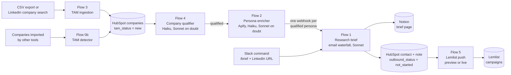

# GTM outbound workflows (n8n + Claude API)

An outbound engine I designed and built in n8n with the Claude API, then ran on a self-hosted instance in April and May 2026. It takes a raw list of companies and turns it into scored accounts, qualified decision-makers, a research brief and a first email draft for each person, a clean HubSpot record and a Lemlist enrollment.

- **7 workflows, 157 nodes**, with HubSpot as the system of record
- **Claude Haiku** scores every company and every persona with a numeric rubric. **Claude Sonnet** reviews only the doubtful verdicts and writes the research briefs
- **Apify** for LinkedIn data, a **4-provider email waterfall** (Hunter, FullEnrich, Lusha, Surfe), **Notion** for briefs, **Slack** for monitoring, **Lemlist** for sending

> This is a sanitized copy for portfolio review. Credentials, IDs, URLs and real data are removed. The prompts are English versions of the production prompts, without targeting details. Slack and Notion messages are still in French because the engine targeted the French market.

## Pipeline



HubSpot properties carry the state from one flow to the next (`tam_status`, `persona_enrichment_status`, `persona_status`, `outbound_status`). Each flow runs on its own trigger or schedule, can stop at any time and resumes where it left off. Every flow reports to Slack, and failures go to a central error workflow.

## The workflows

| Flow | Trigger | What it does |
|---|---|---|
| [3. TAM ingestion](docs/flow-3-tam-ingestion.md) | Form: CSV upload or LinkedIn company search | Normalizes companies from any CSV export or from an Apify LinkedIn search, dedupes them on domain against HubSpot, skips companies refreshed in the last 30 days and batch-upserts the rest |
| [0b. TAM detector](docs/flow-0b-tam-detector.md) | Hourly | Tags companies that other tools imported into HubSpot, so they enter the same pipeline |
| [4. Company qualifier](docs/flow-4-company-qualifier.md) | Daily, form or webhook | Scores new companies with Haiku (industry 40, country 25, size 20, growth signals 15), sends doubtful verdicts to Sonnet, writes status, score and reasons to HubSpot |
| [2. Persona enricher](docs/flow-2-persona-enricher.md) | Hourly, 06:00 to 15:00 | For qualified companies: two-pass Apify employee scrape, title and location filters, in-house team detection, Haiku persona scoring with Sonnet review, then business rules that keep one decision-maker per account |
| [1. Research brief](docs/flow-1-research-brief.md) | Webhook from Flow 2 or a Slack command | Profile, company page and recent posts, email waterfall, Sonnet brief (motivation, communication style, approach plan, first email), Notion page, HubSpot contact and note, Slack summary |
| [5. Lemlist push](docs/flow-5-lemlist-push.md) | Daily or webhook | Sends qualified contacts to the right Lemlist campaign for their persona tier, with a dry-run preview mode, then marks them as sent in HubSpot |
| [Error handler](docs/monitoring-and-errors.md) | Any failed execution | Posts the workflow, node and error message to Slack |

## Engineering choices

1. **The model scores, the code decides.** Haiku returns a breakdown of points at temperature 0. A Code node then re-checks it: each criterion is capped at its maximum, size points are recomputed from the employee count, a disqualification only counts if it cites one of the numbered reasons, and the final status comes from the sum and the threshold, not from the model's own yes or no.
2. **Escalate only the doubtful cases.** Verdicts close to the threshold, the disqualification reasons that proved error-prone and suspicious patterns (a software vendor scored as an IT services firm, for example) go to Sonnet with the Haiku verdict attached. Sonnet's verdict replaces Haiku's, the CRM reason is tagged as reviewed, and an audit object in the execution data keeps both scores and flags when Haiku was wrong.
3. **Explainable CRM records.** Every company and contact gets its score, its breakdown and the reason in HubSpot (`qualified_reason` or `disqualif_reason`). Anyone can see why an account is in the pipeline and challenge the rubric.
4. **Statuses as hand-offs.** Each flow reads one status and writes the next one, oldest records first. A record leaves a queue only when its next status is written, so the next run simply picks up after a crash. The scoring and enrichment runs count the remaining work first and stop cleanly when the queue is empty.
5. **Cost control.** The static rubric is sent as a cached prompt prefix. The second, wider employee scrape only runs for companies where the first pass found a decision-maker. Posts are capped at 3 from the last 6 months. Companies refreshed and people briefed in the last 30 days are skipped. HubSpot writes go through batch endpoints, 100 records per call, throttled.
6. **Data quality gates.** Companies are keyed on a normalized domain, stored in a custom unique property that the batch upsert uses as its ID. A person must still work at the company and be based in the target market. A HubSpot contact is never created without an email: those cases go to a run log instead. Job titles are cleaned before mail merge.
7. **Business rules live in code, not only in prompts.** One decision-maker per account: a Head of Sales outranks a Head of GTM, and a founder is only used when no sales leader qualifies, never when the founder is technical (CTO, CPO and similar). Companies that already employ a GTM or RevOps engineer are disqualified, because they do not need an outside builder.
8. **Observable and safe to operate.** Every stage posts counts, scores and reasons to a Slack monitoring channel, and most notification nodes continue on error so monitoring cannot stop a run. The Lemlist push has a preview mode that lists who would be enrolled before anything is sent.

## How I built it

I built the workflows with Claude Code, through the n8n REST API instead of the editor: 27 Python scripts created, configured, tested and fixed the flows, and a JSON snapshot was saved before each major change (143 snapshots). Changes were made a few nodes at a time and tested node by node. [Lessons learned](docs/lessons-learned.md) lists what this taught me about n8n, the models and the data.

Build log, 2026:

| Date | Milestone |
|---|---|
| 23 April | Brief pipeline and list builder created through the API |
| 29 April | HubSpot becomes the system of record for companies and contacts |
| 3 May | The single list builder is split into 4 independent flows that hand off through HubSpot statuses |
| 4 May | Sonnet review of doubtful verdicts, rubric iterations, batch upserts, Slack monitoring, central error handler, full email waterfall, email guard |
| 5 May | Lemlist push flow, two-pass Apify architecture, founder fallback and technical co-founder exclusion, schedules |
| 6 May | Prompt caching, Apify cost optimizations, 30-day skip for briefs, posts capped, LinkedIn company search in TAM ingestion |
| 8 May | Fallback for encoded LinkedIn URLs, TAM detector for companies imported by other tools |

What I would do next:

- Move the market settings (country, size range, target titles) from prompts and code into one config node
- Persist the audit data and build a labeled set, to measure precision and recall of the Haiku and Sonnet verdicts after each rubric change
- Unit-test the Code nodes outside n8n (they are plain functions, see [code/](code/))
- Replace the fixed wait on the asynchronous enrichment provider with polling

## Repository map

```
workflows/   the 7 n8n exports, ready to import
docs/        one page per flow, plus architecture, setup, monitoring and lessons learned
prompts/     the 3 Claude prompts, with design notes
code/        the main Code nodes as plain .js files, easy to read on GitHub
```

Start with [docs/architecture.md](docs/architecture.md) for the data model, or [docs/setup.md](docs/setup.md) to run it yourself.

---

William Nguyen, GTM Engineer · [LinkedIn](https://www.linkedin.com/in/ntaw)
