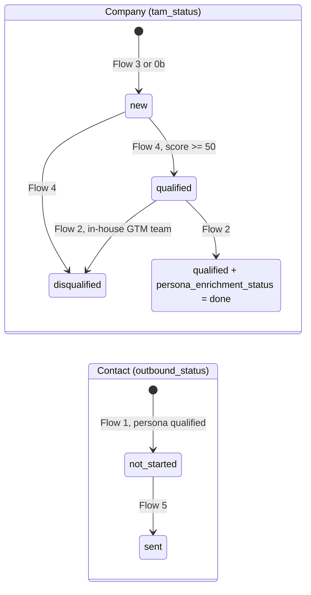

# Architecture

## Principles

- **HubSpot is the system of record.** Every company found is stored, qualified or not, with its score and the reason. Later runs read HubSpot first and skip companies refreshed in the last 30 days.
- **Small flows that hand off through statuses.** Each flow owns one step, reads one status and writes the next one. Flows can run on different schedules, be re-run safely and be debugged one at a time.
- **Cheap model first, expensive model on doubt.** Claude Haiku scores everything; Claude Sonnet only reviews the doubtful verdicts and writes the briefs, where quality matters most.
- **Humans see everything.** Slack shows each stage with counts and per-record reasons; Notion holds the briefs; HubSpot holds the reasons next to each record.

## Pipeline and schedules

| Order | Flow | Reads | Writes | Schedule |
|---|---|---|---|---|
| 1 | Flow 3, TAM ingestion | a CSV or a LinkedIn company search | companies with `tam_status = new` | on demand (form) |
| 1b | Flow 0b, TAM detector | companies without `tam_status` | `tam_status = new` | hourly |
| 2 | Flow 4, company qualifier | `tam_status = new` | `qualified` or `disqualified`, score, reason | daily at 07:00, 50 companies |
| 3 | Flow 2, persona enricher | `qualified` and not yet enriched | `persona_enrichment_status = done`, then one Flow 1 call per qualified persona | hourly from 06:00 to 15:00, 10 companies per run |
| 4 | Flow 1, research brief | a LinkedIn profile URL | Notion brief, HubSpot contact (`persona_status = qualified`, `outbound_status = not_started`) and note | on demand (webhook) |
| 5 | Flow 5, Lemlist push | `qualified` and `not_started` contacts | Lemlist lead, `outbound_status = sent` | daily at 11:00, up to 100 contacts |

The numbering follows the build order, not the pipeline order. Schedules use the n8n instance timezone.

## Status lifecycle

## HubSpot data model

Custom properties are in **bold**. The other properties are standard HubSpot properties.

### Companies

| Property | Values | Written by | Used for |
|---|---|---|---|
| **`tam_domain`** | normalized domain, unique | Flows 3, 0b | key of the batch upsert and of the pre-lookup |
| **`tam_status`** | `new`, `qualified`, `disqualified` | Flows 3, 0b, 4, 2 | queue of each flow |
| **`tam_first_seen`** | date | Flows 3, 0b | oldest-first processing |
| **`tam_last_scrap`** | date | Flow 3 | 30-day refresh window |
| **`tam_industry`** | raw industry label from the source | Flows 3, 0b | context for scoring |
| **`score_icp`** | 0 to 100 | Flows 4, 2 | prioritization |
| **`qualified_reason`**, **`disqualif_reason`** | points breakdown, verdict, review tag, date | Flows 4, 2 | explainability |
| **`persona_enrichment_status`** | empty or `done` | Flows 3, 2 | queue of Flow 2 |
| `name`, `domain`, `website`, `description`, `numberofemployees`, `linkedin_company_page`, `industry`, `country`, `state`, `city` | | Flow 3 | firmographics; `industry` is mapped to the HubSpot enum |

### Contacts

| Property | Values | Written by | Used for |
|---|---|---|---|
| `email` | | Flow 1 | key of the batch upsert |
| **`tam_linkedin_url`** | LinkedIn profile URL | Flow 1 | 30-day brief skip, Lemlist lead |
| **`persona_status`** | `qualified` | Flow 1 | queue of Flow 5 |
| **`persona_tier`** | `1_cro_vp_sales`, `2_director_of_sales`, `3_revops_lead`, `4_ceo_fallback` | Flow 1, from Flow 2 | campaign routing |
| **`score_persona`** | 0 to 100 | Flow 1, from Flow 2 | prioritization |
| **`qualified_reason`** | persona verdict from Flow 2, plus the SDR, BDR, AE and CSM counts found at the company | Flow 1 | explainability |
| **`rice_preview`** | one-line summary of the brief | Flow 1 | quick read in the CRM |
| **`job_title_lemlist`** | cleaned job title, empty for founders | Flow 1 | mail merge |
| **`flow1_last_brief_date`**, **`tam_last_scrap`** | date | Flow 1 | 30-day brief skip |
| **`outbound_status`** | `not_started`, `sent` | Flows 1, 5 | queue of Flow 5 |
| **`outbound_sequence_id`** | Lemlist campaign ID | Flow 5 | traceability |
| `firstname`, `lastname`, `company`, `jobtitle`, `city`, `country`, `hs_linkedin_url` | | Flow 1 | contact data |

Each brief is also stored as a HubSpot note (HTML) associated with the contact.

## Notion

- **Leads database**: one page per prospect with the full brief (motivation, communication style, rapport openers, approach plan, first email draft) and properties for score, tier, priority, motivation and style. Pages are looked up by LinkedIn URL and updated in place instead of duplicated.
- **Run log database**: entries for runs that need a human look, for example a persona dropped because no email was found.

## External services

| Service | Role | Flows |
|---|---|---|
| Claude API | scoring (Haiku), review and briefs (Sonnet) | 4, 2, 1 |
| Apify | LinkedIn company search, company pages, employees, profiles, posts | 3, 2, 1 |
| Hunter, FullEnrich, Lusha, Surfe | email waterfall, first match wins | 1 |
| HubSpot | system of record | all |
| Notion | briefs and run log | 1 |
| Lemlist | sequences | 5 |
| Slack | monitoring, briefs, errors | all |
